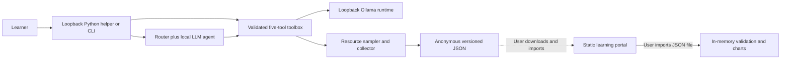

# Architecture and trust boundaries

The static portal has no backend and never contacts the local runtime. Only same-origin static assets/examples are fetched. Optional quiz/prediction storage needs an explicit checkbox; benchmark imports stay in memory and clearing removes them. Imported strings use text nodes, never interpreted HTML. A CSP restricts resource origins. The learning record is separate from benchmark exports and is a formative practice instrument.

The helper binds only to127.0.0.1. Its allowed Host/Origin checks and per-launch session token prevent a generic remote page from issuing authenticated actions. Action keys and arguments are bounded; parallel experiments are rejected. Output file downloads use a fixed route, not caller-selected paths. The helper supports manual deployment; it does not execute model-generated shell commands, start a runtime, change security settings, or download arbitrary content.

The agent's five custom tools have explicit schemas, type/range checks, and finite numeric limits. The deterministic router's first-tool choice is preserved in the trace, so a successful routed catalog lookup is not mislabeled as LLM planning. The LLM can make subsequent tool calls within bounded rounds. Logs, quoted text, and tool results are untrusted evidence rather than instructions. Guardrails redact common credential patterns, check advice, request one rewrite, and remove remaining detected unsafe text. Pattern checks are imperfect and independent review is required; a clean regex result is never a safety certificate.

Runtime URLs are loopback-only and disallow credentials, proxies, redirects, arbitrary API prefixes, escaped hostnames, and external DNS. Inference is gated on standard-user execution, exact approved tag, runtime inventory/digest, complete total footprint, free disk, and available memory. Runtime-reported metadata is evidence of what the server claims, not independently verified publisher provenance. Mutable tags and unpinned distributions remain a limitation.

The collector serializes benchmarks with in-process and OS-level locks. Endpoint-owner and refreshed child-process attribution avoids silently using the UI/Python client's memory as model memory. OS permission failures leave CPU/RAM unavailable. JSON excludes raw prompts/output, usernames, filesystem paths, machine hostnames, and personal tester labels. A new random alias per session avoids persistent device tracking but must be reconciled by a consenting study coordinator if comparing repeated sessions on one device. Runtime metadata can still reveal hardware characteristics; review before sharing.

No telemetry upload endpoint is included. Study records, raw transcripts, participant details, local logs, runtime binaries, and model weights remain outside version control. Keep any future client deployment and data retention decisions separate from this public educational source repository.
